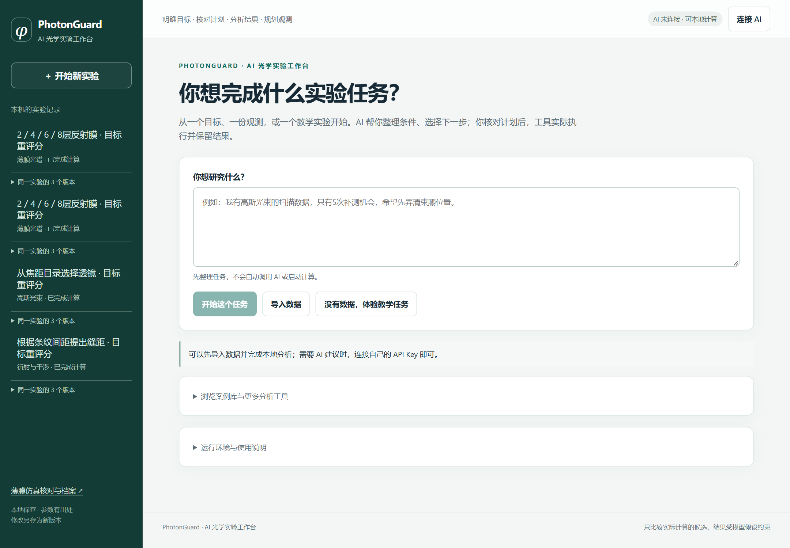
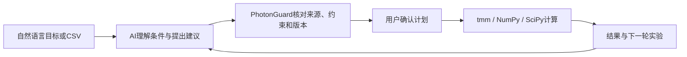

# PhotonGuard

**让光学实验从一句需求开始，也能带着结果继续。**

AI 连续实验工作台 · 薄膜 / 高斯光束 / 双缝 · `0.2.0rc9` · GPL-2.0-or-later

PhotonGuard 将自然语言目标、实验条件、数值计算和后续分析组织在同一个任务中。使用者可以描述目标、导入 CSV、比较候选，再带着已保存的结果修改目标或安排下一次观测。

[下载完整项目](https://github.com/zhouqiuyu114514-beep/aic/archive/refs/heads/main.zip) · [快速开始](#快速开始) · [实际案例](#实际案例) · [视频制作](#视频制作) · [技术报告](materials/PhotonGuard_技术报告.pdf) · [展示稿](materials/PhotonGuard_项目展示.pdf)



## PhotonGuard 能做什么

- **从一句需求形成计算计划。** AI 整理条件与单位，工作台核对原文来源、缺项和范围，用户确认后进入计算。
- **修改目标时保留实验条件。** 条件、计划、结果按版本保存；已有数值满足新评价要求时直接复用。
- **让下一步建议接上工具。** AI 在允许范围内提出后续观测建议，用户批准后执行并联合分析。
- **从已有案例或自己的数据开始。** 提供12个本地案例，支持CSV输入、结果查看与导出。

| 场景 | 设计与比较 | 数据分析 |
|---|---|---|
| 薄膜 | 比较层数与反射、透射结果 | 根据校准反射率和已知折射率筛选膜厚候选 |
| 高斯光束 | 比较透镜条件与屏幕光斑 | 根据纵向光斑半径数据估计束腰参数 |
| 双缝 | 查看几何条件与强度、条纹的关系 | 根据强度数据估计受限几何参数 |

## AI 与开源工具怎样配合



AI 通过使用者自己的 DeepSeek API 账户接入，负责理解与建议；PhotonGuard 自主实现条件核对、计划绑定、执行管理和跨轮结果复用；开源数值工具产生实际计算结果。第三方库及其职责见[资源清单](materials/开源与第三方资源使用清单.md)。

## 快速开始

### 1. 下载完整项目

在仓库上方点击 **Code → Download ZIP**，右键“全部解压”。进入解压后包含本README的目录，保留 `app/` 和 `materials/` 的完整结构。

### 2. 先看已有成果

双击 **打开视频素材.html**，直接浏览两份保存结果、报告和截图。这个入口无需API Key，也不会自动请求模型或计算。HTML应下载后在本机浏览器打开。

### 3. 启动工作台

启动器支持 **Windows x64 + Ubuntu WSL**。

1. 未安装Ubuntu WSL时，双击 **首次准备环境.bat**，按提示安装、重启，再打开Ubuntu完成用户名与密码设置。
2. 双击 **启动工作台.bat**。首次需要联网下载锁定的运行环境，后续启动复用缓存。
3. 等待启动窗口显示成功，浏览器会自动打开工作台。真实AI在页面“连接AI”中填写自己的DeepSeek API Key。
4. 核对计算计划并批准后执行新计算。使用结束时双击 **停止工作台.bat**。

本入口目前以Windows x64与Ubuntu WSL交付；macOS、ARM Windows与无WSL的原生Windows Python不在该启动器验证范围内。已有Linux环境的使用者可参考 [源码说明](app/source/README.md) 与 `app/source/START_PORTABLE.sh`。

首次依赖下载失败可检查网络后重新启动。若浏览器拒绝连接，先查看启动窗口是否成功，使用窗口给出的实际地址。更完整的说明见 [同学使用与视频指南](docs/同学使用与视频指南.md)。

## 实际案例

### 连续修改：850 nm达标，换到700 nm后重新判断

四种薄膜候选的计算结果已经保存。用户只修改评价波长，材料、实际层厚、候选和采样点保持不变。

| 评价目标 | 保存的结果 | 后续处理 |
|---|---|---|
| 850 nm，反射率至少75% | 8层反射率86.02%，达到目标 | 首次计算4个候选 |
| 改为700 nm，仍至少75% | 四候选均未达标，6层最高52.73% | 复用原数值，新保存判定，新增求解0次 |

下载后打开 [850 nm保存结果](materials/film-initial.html) 与 [700 nm后续结果](materials/film-followup.html)。这是同一实验的目标修改与结果复用，不是把8层器件优化成6层。原任务完成于2026-10-18，数字及调用阶段见 [主案例记录](materials/主案例采样与调用阶段核对.json)。

### 安排下一次观测：膜厚候选12组收窄至1组

历史教学合成任务在0–1000 nm搜索范围内，利用633 nm观测得到12组候选。AI选择后续850 nm观测，经批准取得教学数据，与原数据联合分析，保留1组约208.19 nm的候选。

该案例体现补充观测与工具接续，来源为教学合成数据。详见 [历史案例记录](materials/历史12到1案例核对.json) 与技术报告第10页。

## 视频制作

- [4分钟分镜、旁白与来源](materials/视频制作流程.md)
- [队友下载、启动与录制指南](docs/同学使用与视频指南.md)
- [可编辑PPT](materials/PhotonGuard_项目展示.pptx)
- [真实截图](materials/视频素材/) 与 [矢量流程图](materials/原创矢量图/)

既定视频可使用保存结果制作，无需为录制重新付费跑旧案例。画面保留“保存记录”和“教学合成数据”等对应来源标注；真实新操作另行保存记录。录屏不展示API Key、账户资料或个人通知。正式MP4由团队完成后另行发布。

## 代码与复用

```text
PhotonGuard/
├─ README.md
├─ LICENSE
├─ 启动工作台.bat
├─ 首次准备环境.bat
├─ 停止工作台.bat
├─ 打开视频素材.html
├─ app/
│  ├─ launcher/              WSL启动与环境准备
│  └─ source/
│     ├─ photonguard/        产品代码、页面与本地案例
│     ├─ tests/             软件测试
│     └─ pyproject.toml     项目依赖与入口
├─ materials/               报告、展示、只读结果与视频资料
└─ docs/                    使用指南与交付来源
```

工作台的个人任务保存在 `app/data/`，日志位于 `app/logs/`，两者均从Git上传范围排除。Key通过页面连接，不要写入代码或提交到仓库。

`app/`保留已核验运行包原字节，启动器会检查源码清单。要研究或修改代码，请在独立开发副本中按源码说明运行；不要直接修改面向试用的校验清单来绕过检查。

本仓库是 `0.2.0rc9` 的交付快照，源码来源提交为 `176976938f9a6d0603c4799339623227aae35c90`，材料更新于2026-10-20。本次更新接续本仓库10月5日的已有提交，维护源码来源提交记录仍单独保留。文件映射见 [交付来源](docs/交付来源.md)；保存证据的范围与软件测试批次见技术报告。

## 许可证与第三方资源

项目代码采用 **GPL-2.0-or-later**，见 [LICENSE](LICENSE)。Python、NumPy、SciPy、tmm等依赖沿用各自许可；DeepSeek使用远程API服务。完整列表见 [第三方资源清单](materials/开源与第三方资源使用清单.md) 与 [第三方说明](THIRD_PARTY_NOTICE.md)。

报告中的官方模板标识、字体及其他第三方素材按各自授权处理；代码许可证不替代这些素材的权利声明。安装环境、模型权重、个人密钥和私人实验记录不随仓库分发。

## 团队与反馈

**PhotonGuard · AIC-2026-26849458**

| 成员 | 分工 |
|---|---|
| 周秋宇 | 需求决策、制作统筹与试用反馈 |
| 谢烨新 | 操作测试 |
| 曾海达 | 数据与结果核对 |

AI辅助研发与材料制作在技术报告中披露。反馈问题可在仓库Issues提供系统版本、操作步骤与错误信息，并先去除Key和个人数据。当前功能定型，后续以使用修整、兼容性和文档维护为主。
